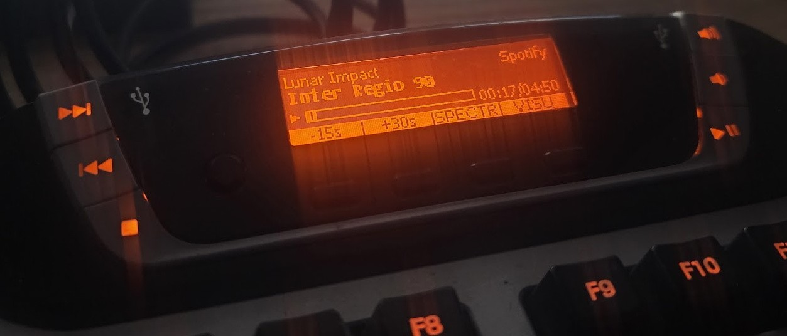

# G15-Retro-HUD


-FF8C00)


**Dashboard autonome en espace utilisateur pour redonner vie à l'écran LCD monochrome (`160×43`) des claviers Logitech G15 (v1 & v2) sous Windows 11, sans aucun pilote propriétaire.**

> **🇬🇧 English TL;DR:** **G15-Retro-HUD** is an independent, user-space Python dashboard for the classic **Logitech G15 (v1 & v2)** 160×43 monochrome LCD and softkeys on **Windows 11 x64**. No legacy Logitech drivers (LGS / G HUB) are required, so Windows 11 Core Isolation / Memory Integrity (HVCI) stays 100% intact. UI and docs are currently in French; English translation is on the roadmap and PRs are very welcome!



---

## Pourquoi ce projet ?

En retombant sur mon vieux clavier **G15** qui approche doucement de ses 20 ans, j'ai eu envie, par pure nostalgie, de rallumer son petit écran LCD sous Windows 11 sans installer d'anciens pilotes noyau obsolètes qui obligent à désactiver la sécurité de Windows.

Ce dashboard a été *vibe-codé* avec plaisir sous la forme d'un script Python unique, lisible et autonome (`g15_dashboard.py`). C'est un projet très humble : si vous avez encore un G15 sur votre bureau ou au fond d'un placard, j'espère qu'il vous servira autant qu'à moi. **Le projet est ouvert à tous** : retours, idées, correctifs et nouvelles démos 1-bit sont les bienvenus !

---

## Points forts techniques

* **Zéro pilote propriétaire (HVCI intact) :** communication directe en espace utilisateur via **USB Raw HID** avec l'écran GamePanel (`160×43` pixels, 1-bit) et les 5 boutons sous l'écran des claviers **G15 v2** (`046d:c227`, ambré) et **G15 v1** (`046d:c222`, bleu). Aucun pilote `.sys` en *ring 0* : l'Isolation du noyau / Intégrité de la mémoire de Windows 11 reste 100 % active.
* **Zéro dépendance cachée pour le GPU et le réseau :** `nvml.dll` (charge %, VRAM et température des GPU NVIDIA), `iphlpapi.dll` (table de routage Windows / détection automatique de tunnel VPN) et `user32.dll` sont appelées directement via `ctypes` en bibliothèque standard : inutile d'installer `pynvml` ou `pywin32`, et aucun sous-processus PowerShell n'est lancé sur un PC équipé d'un GPU NVIDIA (bascule automatique sur les compteurs WMI iGPU sur ultraportable / Surface).
* **Dégradation gracieuse :** seuls `hidapi`, `psutil` et `pillow` sont obligatoires. La capture audio WASAPI, les métadonnées média Windows et l'icône System Tray restent optionnelles.
* **Rendu 1-bit net & Hot-plug USB :** rendu Pillow strict sans antialiasing (`fontmode = "1"`) avec la police système `Tahoma` 9 px pour conserver des accents français nets au pixel près, et reconnexion USB automatique toutes les 2 secondes (sortie de veille ou débranchement de dock).

---

## Prérequis & Installation

* **Windows 10 / 11 (x64)**
* **Python 3.11 ou supérieur** (`tomllib` fait partie de la bibliothèque standard depuis Python 3.11, ce qui correspond également au minimum requis par les roues binaires `winrt-*` sur PyPI).

> [!WARNING]
> **Piège de nommage sur PyPI (`hidapi` vs `hid`) :** installez bien **`hidapi`** et surtout **pas** le paquet homonyme `hid` sur PyPI, qui expose une API incompatible avec `hid.device()`.

### 1. Cloner le dépôt

```bash
git clone https://github.com/DPKoss/G15-Retro-HUD.git
cd G15-Retro-HUD
```

### 2. Installer les dépendances Python

**Installation complète recommandée (toutes les fonctionnalités) :**
```bash
pip install -r requirements.txt
```
*(Ou directement en une seule commande :)*
```bash
pip install hidapi psutil pillow pystray pyaudiowpatch numpy winrt-runtime winrt-Windows.Foundation winrt-Windows.Media.Control
```

**Installation minimale (sans spectre audio, sans contrôle média Windows ni icône System Tray) :**
```bash
pip install hidapi psutil pillow
```

### Détail des paquets `pip`

| Paquet `pip` | Rôle dans `g15_dashboard.py` | Statut |
| :--- | :--- | :--- |
| `hidapi` | Communication USB Raw HID (`import hid`) | **Obligatoire** |
| `psutil` | Sondes CPU, RAM, batterie et compteurs réseau par carte | **Obligatoire** |
| `pillow` | Rendu graphique 1-bit 160×43 et polices Windows (`PIL`) | **Obligatoire** |
| `pystray` | Icône et menu clic-droit dans la zone de notification Windows | Optionnel *(repli console)* |
| `pyaudiowpatch` | Capture audio temps réel en WASAPI Loopback | Optionnel *(mode sans spectre)* |
| `numpy` | FFT 20 bandes, encodage HID vectorisé et effets Demoscene | Optionnel *(repli Python pur)* |
| `winrt-runtime` | Socle CPython partagé des projections PyWinRT | Optionnel *(écran Média)* |
| `winrt-Windows.Foundation` | Types asynchrones `IAsyncOperation` requis par les `await ..._async()` | Optionnel *(écran Média)* |
| `winrt-Windows.Media.Control` | Session média Windows GSMTC (titre, artiste, timeline, seek) | Optionnel *(écran Média)* |

---

## Lancement & Configuration

```bash
python g15_dashboard.py
```

> [!TIP]
> **Exécution en arrière-plan sans console :** une fois le bon fonctionnement vérifié, lancez le script avec `pythonw g15_dashboard.py` pour qu'il tourne silencieusement dans la zone de notification Windows (System Tray).

Au premier lancement, le script crée automatiquement deux fichiers locaux (ignorés par Git) :
* **`config.toml` :** permet d'ajuster les FPS, la priorité Wi-Fi / Ethernet, les 3 serveurs à pinger, la ville météo de repli sous VPN et les délais du mode plein écran. Modifiable à chaud d'un clic droit sur l'icône System Tray $\rightarrow$ **Recharger config.toml**.
* **`g15_keymap.json` :** mappage des 5 boutons sous l'écran (préconfiguré par défaut pour le G15 v2 `046d:c227`). Sur un **G15 v1** (`046d:c222`) ou en cas de besoin, faites un clic droit sur l'icône System Tray $\rightarrow$ **Recalibrer les boutons** et suivez les instructions affichées sur le LCD.

---

## Guide des 8 écrans & Boutons

* **Bouton rond déporté (Applet) :**
  * **Appui court :** passe à l'écran suivant (`1/8` à `8/8`).
  * **Appui long (> 0,9 s) :** éteint ou rallume le rendu de l'écran LCD.

| # | Écran | Contenu affiché | Boutons `[1]` `[2]` `[3]` `[4]` |
| :-: | :--- | :--- | :--- |
| **1** | **Horloge** | Heure grand format, date, charge CPU ou batterie, uptime Windows | `12/24` · `SEC` · `UPT/DATE` · `-` |
| **2** | **Chrono / Minuteur** | Chronomètre au 1/10e avec tours ou minuteur avec alerte flash inversée | `START/PAUSE` · `TOUR/DURÉE` · `RESET` · `MODE` |
| **3** | **Monitoring** | Jauges CPU / RAM / GPU (ou Batterie), historique, jusqu'à 64 threads, °C NVIDIA | `VUE` · `CORES` · `BAT/GPU` · `PICS` |
| **4** | **Média & Visu** | Titre/Artiste/App (Spotify, navigateur, VLC…), seek temporel, spectre live & **4 visualiseurs plein écran** (Spectre Winamp, Oscillo WMP, Tunnel Basses, Double VU-mètre L/R) | `-15s` · `+30s` · `SPECTR` · `VISU` *(puis navigation plein écran)* |
| **5** | **Réseau** | Oscilloscope Download/Upload de la carte physique active (sans double comptage VPN/WSL) + Go cumulés | `PAUSE` · `UNITÉ` · `RAZ` · `Total Go` |
| **6** | **Serveurs & VPN** | Pings ICMP sur 3 hôtes configurables, IP locale, IP publique et badge `[VPN]` auto | `IP LOC / SERV` · `-` · `-` · `PING!` |
| **7** | **Météo** | Géo-IP auto hors VPN (ville de repli sous VPN) via Open-Meteo, sprites pixel-art 16×16, prévisions J+6 et courbe 24h | `< JOUR` · `JOUR >` · `24H / JOURS` · `MAJ` |
| **8** | **Demoscene & Pong** | **6 démos 1-bit plein écran 160×43** (Hyperespace, Matrix, Plasma Bayer, Doom Fire, Torus 3D, Rotozoomer) + **mini-Pong jouable** à 20 FPS | `< EFF` · `EFF >` · `AUTO` · `PONG` *(maintien `HAUT`/`BAS` dans Pong)* |

*(Sur les vues immersives **Visu** et **Demoscene**, la barre de légende des boutons se masque automatiquement après 3 secondes pour profiter de toute la dalle `160×43`.)*

---

## Roadmap & Pistes d'évolution

Toute aide ou Pull Request est la bienvenue sur ces prochaines étapes :

- [ ] **Touches macros G1-G6 & banques M1-M3/MR :** prise en charge des touches additionnelles et pilotage des LEDs via Feature Reports HID.
- [ ] **Bascule audio dynamique WASAPI :** changement automatique de flux loopback lorsque Windows bascule de sortie audio par défaut (casque, dock, Bluetooth).
- [ ] **Coupe-micro universel :** indicateur d'état micro (`IAudioEndpointVolume`) et alertes flash prioritaires inter-écrans.
- [ ] **Traduction anglaise (EN) :** internationalisation de l'interface LCD, de `config.toml` et de la documentation.
- [ ] **Découpage modulaire / Portage Rust :** exécutable natif léger autonome (`hidapi`, `windows`, `embedded-graphics`, `tray-icon`).

---

## Contribuer & Contact

Ce projet est ouvert à toutes et à tous, quel que soit votre niveau :
* Ouvrez une **Issue** sur GitHub pour signaler un bug, partager un retour de test (notamment sur **G15 v1 bleu**) ou proposer une idée.
* N'hésitez pas à ouvrir une **Pull Request** pour ajouter un écran, optimiser une sonde ou coder un nouvel effet Demoscene 1-bit.
* **Contact direct :** [dpkoss@proton.me](mailto:dpkoss@proton.me)

---

## Licence & Clause de non-affiliation (Disclaimer)

Ce projet est distribué sous licence **MIT** (voir le fichier [LICENSE](LICENSE) pour plus de détails).

**FR - Clause de non-affiliation :** `G15-Retro-HUD` est un projet personnel, communautaire et strictement indépendant. Son auteur n'est **pas employé par**, ni affilié à, ni sponsorisé, soutenu ou approuvé par **Logitech International S.A.** ou **Microsoft Corporation**. Aucun code, pilote ou SDK propriétaire Logitech n'est inclus ou distribué dans ce dépôt. *Logitech*, *G15* et *GamePanel* sont des marques commerciales ou des marques déposées de Logitech ; *Windows* est une marque déposée de Microsoft Corporation. Ces noms sont mentionnés uniquement à des fins d'identification et d'interopérabilité matérielle.

**EN - Non-Affiliation Disclaimer:** `G15-Retro-HUD` is an independent, hobbyist open-source project. Its author is **not an employee of**, nor affiliated with, endorsed by, or sponsored by **Logitech International S.A.** or **Microsoft Corporation**. No proprietary Logitech code, driver, or SDK is included in this repository. *Logitech*, *G15*, and *GamePanel* are trademarks or registered trademarks of Logitech, used strictly for hardware compatibility identification purposes.